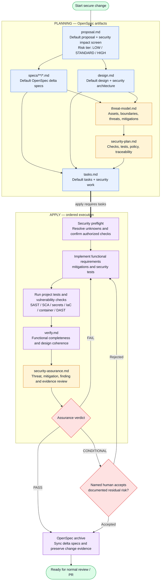

# OpenSpec Secure by Design

`secure-by-design` is a community schema for [OpenSpec](https://github.com/Fission-AI/OpenSpec) that connects observable requirements to threat modeling, mitigations, vulnerability checks, and verification evidence.

The schema does not claim that an LLM is a vulnerability scanner. It orchestrates project-approved scanners and tests, records their coverage, and prevents missing or failed checks from being reported as a clean result.

It extends OpenSpec 1.16.0's bundled `spec-driven` schema additively. The default `spec.md` is unchanged; proposal, design, and task templates retain the complete upstream content before appending security sections; and the default instruction blocks remain intact before their security addenda. See [UPSTREAM.md](UPSTREAM.md).

## Lifecycle



The artifact graph describes file readiness. `verify.md` and `security-assurance.md` become ready after `tasks.md` exists, but the apply instructions produce them only after implementation and checks have run.

## What it covers

- Security-impact screening and a `LOW`, `STANDARD`, or `HIGH` analysis depth
- Standard OpenSpec delta specs, including negative and abuse scenarios
- Assets, actors, data classification, entry points, trust boundaries, and assumptions
- STRIDE-compatible threat identification with stable `THR-*` identifiers
- Mitigation and residual-risk decisions with stable `MIT-*` identifiers
- A traceability chain from requirement to threat, mitigation, task, check, and evidence
- Configurable SAST, dependency, secret, IaC, container, DAST, and project security tests
- A final `PASS`, `CONDITIONAL`, or `FAIL` assurance verdict

## Install

From the root of an initialized OpenSpec project:

```bash
git clone https://github.com/<your-account>/openspec-secure-by-design.git /tmp/openspec-secure-by-design
cp -R /tmp/openspec-secure-by-design/secure-by-design openspec/schemas/secure-by-design
openspec schema validate secure-by-design
```

Optionally install the companion agent skill:

```bash
mkdir -p .agents/skills
cp -R /tmp/openspec-secure-by-design/skills/secure-verify .agents/skills/secure-verify
```

Copy and tailor the scanner configuration:

```bash
cp /tmp/openspec-secure-by-design/config/security-checks.example.yaml openspec/security-checks.yaml
```

Set the schema as the project default:

```yaml
# openspec/config.yaml
schema: secure-by-design
```

Or select it for one change:

```bash
/opsx:new secure-invoice-download --schema secure-by-design
```

## Typical use

```text
/opsx:propose secure-invoice-download --schema secure-by-design
/opsx:status
/opsx:apply
/opsx:verify
/opsx:archive
```

During apply, the agent reads `openspec/security-checks.yaml` when present, asks before running commands that have not already been authorized, and writes the evidence summary into the change directory. Scanner reports may be kept at the configured report paths; secrets and raw sensitive payloads must not be copied into OpenSpec Markdown artifacts.

## Risk scaling

The schema always creates the same artifacts because OpenSpec schemas use a static dependency graph. Their depth scales with the change:

| Tier | Typical change | Required depth |
|---|---|---|
| `LOW` | Documentation, internal refactor, no security-boundary change | Short applicability explanation and normal project checks |
| `STANDARD` | New endpoint, data flow, dependency, or user-visible behavior | Scoped threat analysis, mapped mitigations, applicable scanners |
| `HIGH` | Authentication, authorization, secrets, sensitive data, trust-boundary or infrastructure change | Full model, negative tests, complete evidence, explicit residual-risk owner |

## Verdict policy

- `PASS`: required checks completed and no blocking finding remains.
- `CONDITIONAL`: no unresolved critical/high risk remains; every exception has a named human owner, rationale, and review date.
- `FAIL`: a required check is incomplete, evidence is missing, or a blocking finding remains.

A scanner crash, timeout, missing executable, or invalid report is `INCOMPLETE`, never “zero vulnerabilities.” The default example policy blocks critical and high findings. Projects may strengthen that policy.

## Repository layout

```text
secure-by-design/              OpenSpec schema bundle
  schema.yaml
  templates/
skills/secure-verify/          Optional agent-facing verification workflow
config/                        Example project scanner configuration
scripts/validate-bundle.sh     Local/CI schema validation
tests/test-bundle.sh           Structural contract checks
```

## Validate the bundle

Requires OpenSpec 1.16.0 or newer:

```bash
sh scripts/validate-bundle.sh
sh tests/test-bundle.sh
sh tests/test-upstream-defaults.sh
sh tests/test-lifecycle.sh
```

## Community catalog submission

After publishing the repository, open an issue in `Fission-AI/OpenSpec` with the repository link and this description:

> `secure-by-design` — Threat-model-driven OpenSpec workflow connecting security requirements, STRIDE-compatible threats, mitigations, vulnerability checks, and verification evidence. Failed or unavailable checks are recorded as incomplete, while critical/high findings block archive unless the project’s explicit risk policy permits a documented human-owned exception.

## Security

See [SECURITY.md](SECURITY.md) for responsible reporting. See [CONTRIBUTING.md](CONTRIBUTING.md) before changing artifact IDs, dependencies, verdict semantics, or command-handling rules.

## License

MIT

